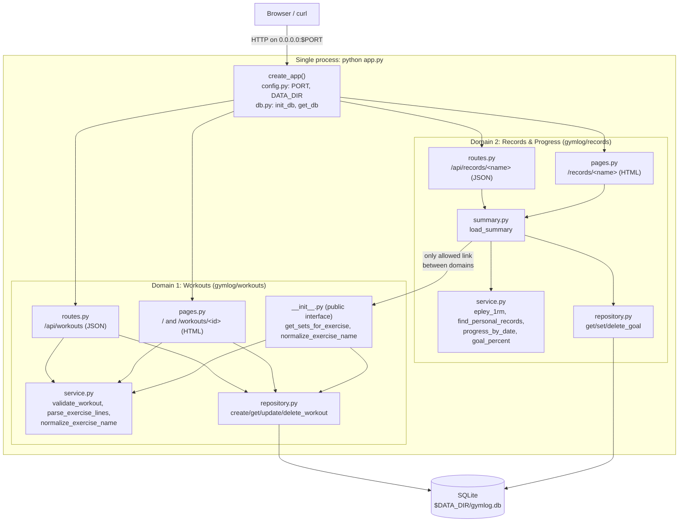
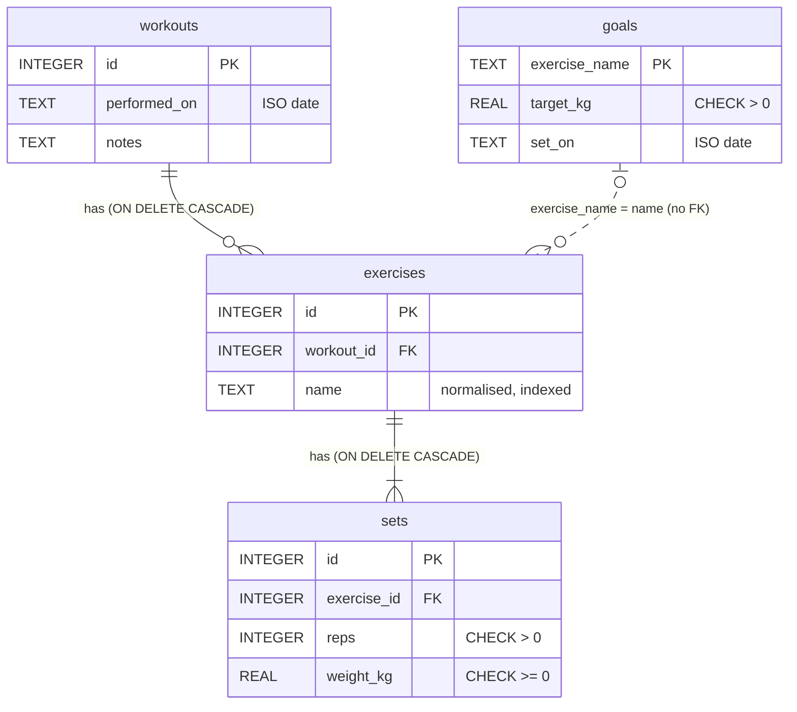
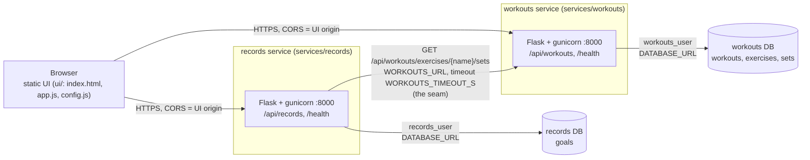
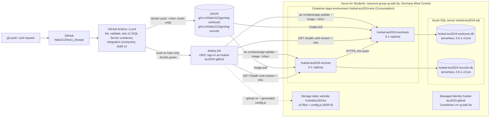
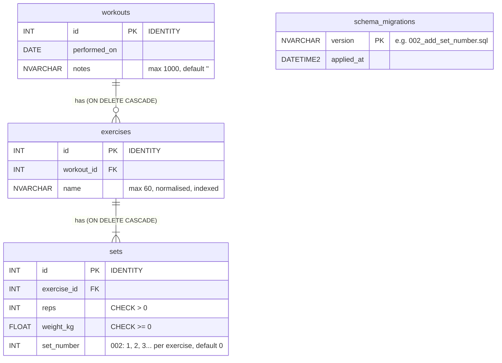
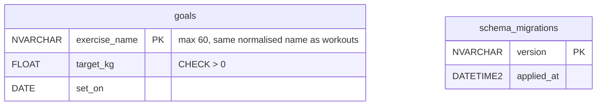

# Gym Log diagrams

GitHub renders the Mermaid blocks below. Part 1 is the Assignment 1 monolith (the "before"),
as it was on 2026-10-03. Part 2 is the split system as deployed for Assignment 2 (the "after").

# Part 1: Assignment 1 monolith (before)

## Architecture

One Python process started by `python app.py`. `create_app()` loads config from environment
variables, runs `init_db` (creates all tables), and registers four blueprints, two per domain.
Each domain is split into routes/pages (HTTP), `service.py` (pure logic) and `repository.py` (SQL).
The records domain reaches workouts data **only** through the public interface in
`gymlog/workouts/__init__.py` (ADR-2).

## Database schema

Created on startup from `gymlog/workouts/schema.sql` and `gymlog/records/schema.sql` (ADR-3).
`goals` belongs to the records domain and has **no foreign key** into the workouts tables: it is
matched to exercises by the normalised name, so records could move to its own database later.

# Part 2: the split system (after, Assignment 2)

Matches the code and the Azure deployment as of 2026-11-22.

## Architecture after the split

Two services, each in its own container with its own database and its own login, which can't open
the other database. The only call across the seam is records asking workouts for one exercise's sets
over HTTP, with a timeout; if workouts doesn't answer, records returns 503 with the goal it owns
(ADR-6, ADR-10). The static UI calls both services from the browser; CORS lets only its origin in.

Locally, `docker compose up --build` runs the same picture: `ui` (nginx:1.27-alpine serving `ui/`,
port 8080), `workouts` (8001), `records` (8002), one `sqlserver` container holding both databases,
and the one-off `db-init` job that creates the databases and logins (`db/init.sql`).

## Deployment

## Database per service (matches the migrations)

`workouts` database, from `services/workouts/migrations/001_init.sql` and `002_add_set_number.sql`:

`records` database, from `services/records/migrations/001_init.sql`. `goals.exercise_name` matches
`exercises.name` in the other database by value only: no foreign key can cross databases, so the
link is kept in code (ADR-7).

